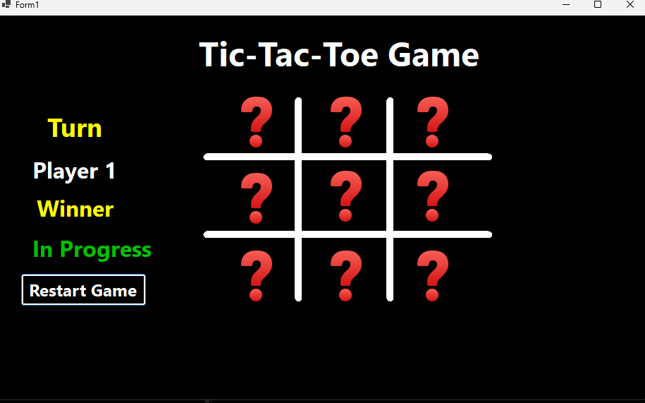
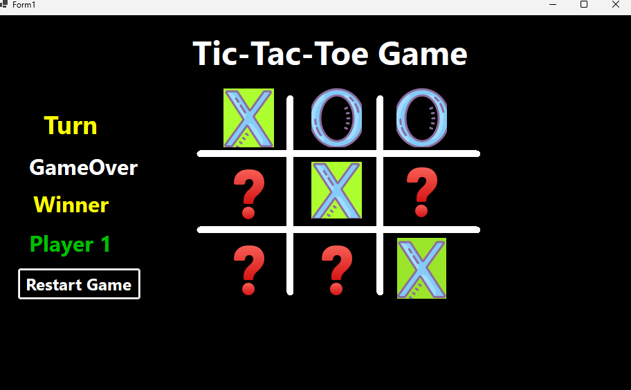
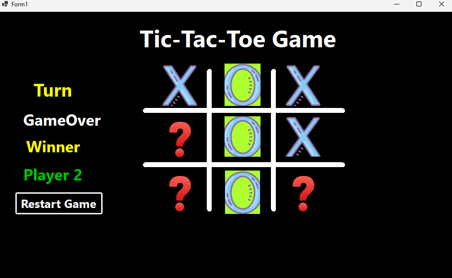
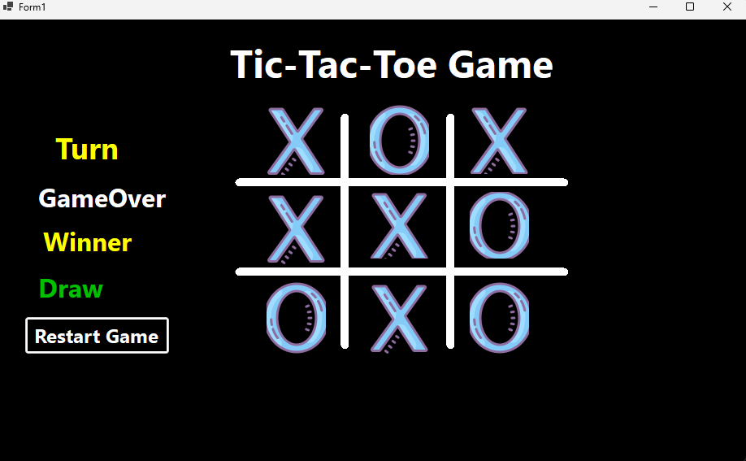

# Tic-Tac-Toe Game — C# Windows Forms

A desktop Tic-Tac-Toe game built with **C# and Windows Forms**. The game allows two players to take turns, tracks the game status, detects wins and draws, and lets players restart the game.

## Screenshots

### Main Screen


### Player 1 Wins


### Player 2 Wins


### Draw


## Features

- Two-player gameplay.
- Alternating turns between Player 1 and Player 2.
- Automatic winner detection.
- Draw detection when the board is full and no player has won.
- Prevents additional moves after the game ends.
- Displays the current turn and game status.
- Restart button to start a new game.
- Windows Forms graphical user interface.

## Technologies Used

- C#
- .NET
- Windows Forms
- Visual Studio

## Getting Started

### Prerequisites

- Visual Studio with the .NET desktop development workload installed.
- A compatible .NET SDK.

### Run the Project

1. Clone or download this repository.
2. Open the solution file (`.sln` or `.slnx`) in Visual Studio.
3. Restore any required dependencies if prompted.
4. Build the project.
5. Run the application.

## How to Play

1. Player 1 and Player 2 take turns selecting cells on the board.
2. The game checks for a winning combination after each move.
3. If a player wins, the winner is displayed.
4. If all cells are filled without a winner, the game declares a draw.
5. Use **Restart Game** to play another round.

## Project Structure

```text
Tic-Tac-Toe/
├── screenshots/
│   ├── Main-screen.png
│   ├── Player1-Winner.png
│   ├── Player2-Winner.png
│   └── Draw.png
├── Form1.cs
├── Form1.Designer.cs
├── Form1.resx
├── Program.cs
├── WinFormsApp4.csproj
└── README.md
```

*Note: The project and solution filenames may differ depending on your local setup.*

## Purpose

This project was developed to practise C# programming, event-driven programming, Windows Forms GUI development, and game logic.

## Author

Hasan Ibraheem
